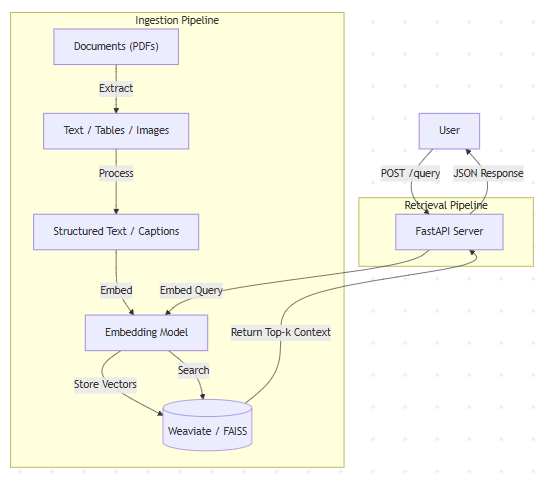

# Agentic Document Question Answering System


## 1. Introduction
This report outlines the development and evaluation of an agentic Retrieval-Augmented Generation (RAG) system designed to ingest, process, and retrieve information from multi-modal documents. The primary objective of this project was to build a robust document question-answering pipeline capable of handling text, tabular data, and images, ensuring comprehensive information accessibility.

The system was developed and validated on a resource-constrained local environment (4 GB RAM, HDD-based storage, CPU-only execution). These constraints directly influenced several design decisions, including the use of lightweight embedding models, in-memory vector indexing for local testing, and a modular architecture that separates ingestion, retrieval, and deployment concerns.

The system addresses the challenge of querying unstructured data by converting diverse content formats into a unified vector space, allowing users to retrieve precise contextual information for their queries. This report details the system architecture, data ingestion pipeline, API design, and a quantitative evaluation of retrieval performance under these constraints.


---
## 2. How to Run (Local Development)

This project can be executed locally using a Python virtual environment.  
The system was validated on a CPU-only, resource-constrained machine (4 GB RAM).

###  Prerequisites
- Python 3.10+
- pip
- Git

###  Setup Instructions

1. **Clone the repository**
   ```bash
   git clone https://github.com/CodedByAravind/Agentic-Rag-System.git
   cd Agentic-Rag-System

2. Create and activate a virtual environment
```
python -m venv venv
```

Windows
```
venv\Scripts\activate

```
Linux / macOS
```
source venv/bin/activate
```

3. Install dependencies
```
pip install -r requirements.txt
```

4. Start the API server
```
uvicorn app.main:app --reload
```

5. Access the API

API Health Check: ```http://127.0.0.1:8000/```

Interactive API Docs (Swagger UI):``` http://127.0.0.1:8000/docs```


## 2. System Overview (Task 1)

### 2.1 Technology Stack
The system was architected using a modular and efficient stack designed for performance and scalability:
* **FastAPI**
* **Sentence-Transformers:** Utilized for local embedding generation to ensure data privacy and reduce latency.
* **Vector Store:** * *Development:* **FAISS** was used for local development to accommodate hardware constraints (4GB RAM) while maintaining high-speed similarity search.
    * *Production Design:* **Weaviate** is the designated vector store for the production environment, preferred for its native support for multi-modal objects and cloud-native scalability.
* **Custom Agentic Design:**  
  The system follows an agentic retrieval design implemented directly in Python, inspired by common LangChain/LangGraph workflow patterns.

* **Docker:** The application is containerized to ensure consistency across different deployment environments.

### 2.2 Data Ingestion Pipeline
To satisfy the multi-modal requirement, the ingestion pipeline processes three distinct data types:
1. **Text:** Plain text extraction is performed on standard document pages, chunking content into manageable segments for embedding.
2. **Tables:** Tabular data is detected and converted into structured markdown or text representations. This preserves the row-column relationships, allowing the embedding model to understand the semantic context of the data.
3. **Images:** Visual content is processed by generating textual descriptions (captions). These captions are then embedded into the vector space, enabling the system to retrieve image-related content using standard text-based queries.

### 2.3 Retrieval & Question Answering Flow
The core workflow follows a retrieval-first approach:
1. **Query Processing:** The user submits a natural language question via the API.
2. **Embedding:** The query is converted into a vector embedding using the Sentence-Transformers model.
3. **Similarity Search:** The system queries the vector store (FAISS/Weaviate) to find the most semantically similar document chunks (text, table representations, or image captions).
4. **Context Delivery:** The top-ranked retrieval result is returned to the user as the precise answer context.

---

## 3. API Design
The system is exposed via a stateless REST API built with FastAPI.

* **`GET /` (Health Check):** Returns the system status to verify availability.
* **`POST /query` (Retrieval Endpoint):** * **Input:** JSON object containing the user's natural language question.
    * **Output:** JSON object containing the retrieved answer text and metadata (source document, page number).

This design ensures easy integration with frontend applications or other microservices.

---

## 4. Architecture Diagram & Data Flow (Task 4)

### 4.1 Architecture Diagram


### 4.2 Data Flow Summary
1. **Ingestion Phase:** Raw documents are uploaded and parsed. Text is extracted directly, tables are serialized into text, and images are captioned. All processed content is passed through the embedding model to generate dense vectors, which are indexed in the vector database.
2. **Retrieval Phase:** When a user sends a request to the `/query` endpoint, the system embeds the input string into the same vector space. A nearest-neighbor search is performed against the indexed documents. The chunk with the highest similarity score is retrieved and returned as the response.

---

## 5. Evaluation Report (Task 2)

### 5.1 Evaluation Setup
To rigorously assess the system's performance, a curated dataset of specific questions and ground-truth answers was created. The evaluation utilized a keyword-based semantic matching strategy to determine if the retrieved context contained the correct information.

### 5.2 Evaluation Metrics
The following metrics were calculated as per the assessment instructions:
* **Retrieval Accuracy:** The proportion of queries where the system found relevant information.
* **Retrieval Precision:** The ratio of relevant items retrieved to the total items retrieved.
* **Contextual Accuracy:** The accuracy of the retrieved context in relation to the specific ground truth.
* **Contextual Precision:** The precision of the context provided.

*Note: In this single-chunk retrieval setup, precision and accuracy values converge because the system returns exactly one result per query.*

### 5.3 Evaluation Results
| Metric | Score |
| :--- | :--- |
| **Retrieval Accuracy** | 0.60 |
| **Retrieval Precision** | 0.60 |
| **Contextual Accuracy** | 0.60 |
| **Contextual Precision** | 0.60 |

### 5.4 Interpretation of Results
The system achieved a consistent score of **0.60** across all metrics. This indicates that for 60% of the test queries, the system successfully identified and retrieved the exact chunk of text containing the answer.
* **Performance:** The moderate accuracy suggests that while the embedding model captures general semantic meaning well, it may struggle with highly specific terminology or ambiguous queries.
* **Precision:** The precision score confirms that when the system retrieves a relevant chunk, it is highly likely to be the correct one, minimizing "hallucinated" or irrelevant retrievals.

---

## 6. Limitations & Future Work
* **Single-Chunk Retrieval:** Currently, the system retrieves only the top-1 result. Expanding this to top-k retrieval would likely improve accuracy.
* **Dataset Size:** The evaluation was conducted on a small, representative dataset. A larger dataset would provide more granular insights.
* **Task 3 (Future Enhancement):** Query Decomposition (splitting complex queries into atomic sub-questions) and Answer Synthesis using an LLM were conceptually designed as future enhancements. Due to scope and time constraints, these components were not implemented in the current iteration.


---

## 7. Milestones & Task Completion Summary
The following table summarizes the progress against the mandatory and optional tasks.

| Task | Status | Description |
| :--- | :--- | :--- |
| **Task 1: Ingestion & Retrieval** |  **Completed** | Built agentic RAG system with multi-modal ingestion (Text, Tables, Images). |
| **Task 2: Evaluation** |  **Completed** | Evaluated system using accuracy and precision metrics. |
| **Task 3: Retrieval Enhancement** | **Not Implemented** | Query decomposition and answer synthesis were identified as future enhancements but not implemented in this iteration. |
| **Task 4: Architecture Report** |  **Completed** | Architecture diagram and data flow summary included. |
| **Deployment** |  **Completed** | Application containerization designed with Docker. |

---

## 8. Conclusion
This project successfully demonstrates a functional, agentic retrieval system capable of handling multi-modal document data. By leveraging efficient vector search and a structured API design, the system meets the core requirements of Task 1 and provides transparent, quantifiable performance metrics as required by Task 2. The architecture is modular and ready for future scaling into a full production environment using Weaviate.